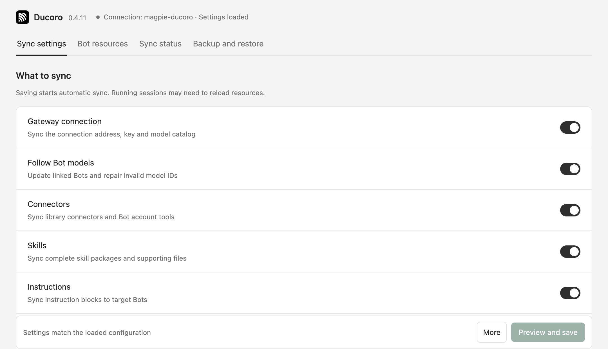

<p align="center">
<a href="https://opc.fish" title="OPC.FISH Project."><picture><source media="(prefers-color-scheme: dark)" srcset="https://raw.githubusercontent.com/YE4IM/readme/main/project/assets/opc-fish-project-signature-web-dark.svg"></picture></a>
</p>

# magpie-ducoro

[English](./README.md) | [**中文**](./README-zh-CN.md)

一个 Magpie 插件，用来把模型、连接器、技能和指令同步到 Ducoro Bot。

[](./LICENSE) [](./package.json) [](./lib/)

[前往快速开始](#快速开始)



[环境要求](#环境要求) · [安装](#安装) · [用法](#用法) · [配置](#配置) · [故障排除](#故障排除) · [变更日志](#变更日志)

## 概述

可以让多个 Bot 共用 Magpie 的默认模型，也可以为各个 Bot 单独选模型。同步前可预览 Ducoro 将收到哪些设置和资源，以及哪些分配会被撤销。

## 环境要求

- 已安装支持插件 Agent 和页面服务的 Magpie。[Magpie](https://usemagpie.ai)
- 已安装并登录 Ducoro，后台服务正在运行，并有权访问要管理的设备和 Bot。[Ducoro](https://ducoro.ai)
- Magpie 使用的 `PATH` 中可以找到 `ducoro-cli`。[下载 Ducoro CLI](https://ducoro.ai/download/cli)

## 安装

在 Magpie 中打开「插件 → 添加插件」，输入 `github:YE4IM/magpie-ducoro#v0.4.11`。也可以在终端使用 Magpie CLI。

```bash
magpie plugin add github:YE4IM/magpie-ducoro#v0.4.11
```

如果使用源码归档，先解压，再通过绝对路径添加解压后的目录。切换版本前，请先停止当前插件宿主。[v0.4.11 发布页](https://github.com/YE4IM/magpie-ducoro/releases/tag/v0.4.11)

## 快速开始

1. 在 Magpie 的「Agent」页面连接 Ducoro 并选择模型，再从 Magpie 侧边栏打开「Ducoro」。
2. 在「同步设置」中检查连接标识、启用的资源类型和目标 Bot。要单独分配资源，打开「Bot 资源」。
3. 点击「预览变化」，核对新增项、撤销项以及是否会首次创建网关连接。如果修改了设置，点击「预览并保存」并确认，开始同步。
4. 打开「同步状态」，核对写入结果和读回核验结果。沿用当前设置时，如需再运行一次同步，可在这里点击「重试同步」。要确认配置已在会话中生效，请在 Ducoro 中用目标 Bot 新建会话，并在会话中检查已同步的设置。

> [!NOTE]
> 文档编写环境未完成插件安装和首次同步验证。只读诊断命令可以运行，但该环境无法连接插件的实时服务。

## 用法

| 任务 | 在 Ducoro 插件页面中的操作 |
| --- | --- |
| 选择模型 | 跟随 Magpie 的默认模型，或按 Bot 分配。可以手动覆盖自动匹配的模型能力。 |
| 分配连接器和技能 | 选择全局分配或按 Bot 分配。某个 Bot 的列表为空时，会清除插件对它的同类分配。要分配 Ducoro 账户连接器的工具，需先在 Ducoro 中连接账户。 |
| 同步指令和子代理 | 选择目标 Bot。插件会更新它管理的指令区块，并同步显式选中的子代理。 |
| 在多个 Bot 间共享设置 | 用方案共享模型、连接器、技能和指令。Bot 的单项设置优先。在保存预览中选择「先让一个 Bot 试用」，核验后再推广。 |
| 核对资源分配 | 用「按资源反查 Bot」追踪技能或资源库连接器。用「对比两个 Bot」查看模型路由、资源、账户工具权限和核验结果的差异。 |
| 恢复管理记录 | 打开「备份与恢复」。恢复管理记录后，点击「预览影响并继续同步」，核对改动后恢复同步。 |

插件界面跟随 Magpie 的语言设置。简体和繁体中文使用中文界面，其余语言使用英文界面。

## 配置

| 选项 | 默认值 | 用途 |
| --- | --- | --- |
| `connectionSlug` | `magpie-ducoro` | Ducoro 模型连接标识 |
| `servicePort` | `3487` | `127.0.0.1` 上的插件页面服务端口 |
| `modelScope`、`mcpScope`、`skillsScope` | `global` | 设为 `agents` 可按 Bot 分配 |
| `targetAgents` | `[]` | 将模型、指令、子代理和按 Bot 分配的资源库内容限制在选定的 Bot |

管理记录默认保存在 `~/.config/magpie/ducoro-bridge/state.json`。已设置 `DUCORO_BRIDGE_STATE_DIR` 时优先使用该目录，否则在有 `XDG_CONFIG_HOME` 时使用其下的 `magpie/ducoro-bridge`。

## 故障排除

如果插件页面打不开，请确认 Magpie 能找到 `ducoro-cli`、Ducoro 后台服务正在运行，且 `servicePort` 对应的端口可用。可在源码目录或解压后的发布目录运行以下只读诊断命令。加上 `--lang zh` 可显示中文，加上 `--json` 可输出结构化结果。

```bash
node diagnostics-cli.mjs --doctor
```

如果管理记录不可读导致同步暂停，请保留原始 `state.json` 及其增量日志。在「备份与恢复」中检查有效备份，恢复后先预览影响，再继续同步。

如果关闭后同步锁仍在，请先停止所有插件宿主，再检查锁。

```bash
npm run lock:inspect -- /absolute/path/to/ducoro-bridge
```

降级时，先停止当前宿主，用当前版本把现有增量日志合并到状态快照，再加载旧版。

```bash
npm run state:compact -- /absolute/path/to/state.json
```

## 变更日志

[版本历史](./docs/CHANGELOG.md) · [最新发布说明](./docs/RELEASE-NOTES.md) · [GitHub Releases](https://github.com/YE4IM/magpie-ducoro/releases)

## 许可证

[MIT 许可证](./LICENSE)。
